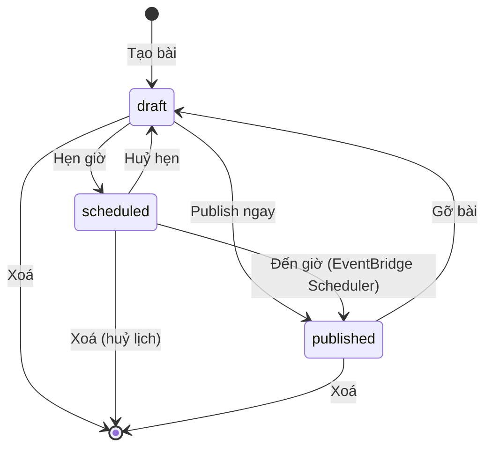

# Thiết kế: Blog cá nhân serverless — oki-dev.xyz

- **Ngày:** 2026-10-10
- **Trạng thái:** Đang thiết kế — Phần 1–4/5 đã duyệt
- **Tác giả:** Son Nguyen

---

## 0. Bối cảnh & mục tiêu

### Mục tiêu

Blog cá nhân, một tác giả duy nhất, viết bài qua trang quản trị trên web. Người đọc chỉ đọc.

### Tiêu chí thành công

- Người đọc mở bài thấy nội dung **ngay lập tức**, chuyển giữa các bài **mượt** (không trắng trang).
- Tác giả viết xong, bấm Publish → bài lên site trong **khoảng 30–60 giây**.
- Chi phí vận hành hàng tháng **gần như 0** ở quy mô blog cá nhân.
- Toàn bộ hạ tầng là code, deploy tự động khi push lên `main`.

### Ngoài phạm vi (phiên bản đầu)

- SEO (không phải ưu tiên).
- Bình luận, đăng ký thành viên, nhiều tác giả, phân quyền.
- Thư viện quản lý ảnh trong database.
- Môi trường dev/staging riêng.

### Quyết định đã chốt

| Chủ đề | Lựa chọn | Lý do |
|---|---|---|
| Mô hình | Có trang quản trị, bài lưu trong database | Viết bài trên web, không cần Git |
| Cách render cho người đọc | **SSG** (sinh HTML tĩnh khi publish) | Tải lần đầu nhanh nhất, gần như không tốn chi phí; không cần SEO nhưng SSG vẫn cho trải nghiệm tốt nhất |
| Chuyển trang | Kiểu SPA sau lần tải đầu (Astro View Transitions) | Ưu tiên đọc mượt |
| Site đọc | **Astro** (TypeScript) | Thiết kế cho site nội dung, gần như không JS, build nhanh |
| Trang quản trị | **React** SPA (Vite, TypeScript) | Ứng dụng tương tác, có đăng nhập |
| Soạn bài | **Markdown** + xem trước | Gọn, dễ sao lưu/di chuyển, tô màu code khi build |
| Backend | **Lambda Node.js** (TypeScript) | Cùng ngôn ngữ với frontend |
| Hạ tầng (IaC) | **AWS CDK** (TypeScript) | Gọn nhất, AWS quản lý state, cùng ngôn ngữ |
| Build khi publish | **Lambda container image** chạy `astro build` | Nhanh (bài lên site trong ~30–60 s), ít thành phần, code site & code build luôn cùng phiên bản |
| Region chính | **`ap-northeast-1` (Tokyo)** | Chứng chỉ cho CloudFront đặt ở `us-east-1` (bắt buộc) |
| Môi trường | Chỉ **prod** | Đủ cho blog cá nhân |
| CI/CD | **GitHub Actions**, push `main` → deploy prod | Tự động hoá, xác thực AWS qua OIDC |

### Tính năng phiên bản đầu

- Viết / sửa / xoá / publish bài (Markdown).
- Upload ảnh trong bài.
- Tag / chuyên mục, có trang liệt kê theo tag.
- Bản nháp & lên lịch tự publish.
- Tìm kiếm bài viết.

### Tên miền

Tên miền `oki-dev.xyz` (mua ở GoDaddy, DNS đã chuyển về hosted zone Route 53).

| Địa chỉ | Dùng cho |
|---|---|
| `blog.oki-dev.xyz` | Site đọc (kèm ảnh ở `/media/*`) |
| `admin.oki-dev.xyz` | Trang quản trị |
| `api.oki-dev.xyz` | API cho trang quản trị |

Tên miền gốc `oki-dev.xyz` để dành cho mục đích khác.

### Giả định

- Một tài khoản AWS, một tài khoản quản trị duy nhất (tác giả).
- Quy mô: vài trăm bài trở xuống.

---

## 1. Kiến trúc tổng thể ✅

### Sơ đồ


> Sơ đồ vẽ bằng [awsdac](https://github.com/awslabs/diagram-as-code), nguồn: [`docs/diagrams/architecture.yaml`](../../diagrams/architecture.yaml).
> Vẽ lại: `rm -f docs/diagrams/architecture.png && awsdac docs/diagrams/architecture.yaml -o docs/diagrams/architecture.png`
> (awsdac hỏi xác nhận nếu file PNG đã tồn tại, nên xoá trước khi vẽ lại.)

<details>
<summary>Phiên bản Mermaid (xem nhanh trên GitHub)</summary>


</details>

### Thành phần

| Thành phần | Vai trò |
|---|---|
| **S3 + CloudFront (blog)** | Phục vụ HTML tĩnh. Ảnh dùng chung distribution qua đường dẫn `/media/*` |
| **S3 + CloudFront (admin)** | Phục vụ SPA React quản trị |
| **Cognito User Pool** | 1 tài khoản quản trị; tắt tự đăng ký; bật MFA |
| **API Gateway HTTP API + Lambda API** | JWT authorizer (Cognito); một Lambda xử lý các route CRUD |
| **DynamoDB** | Lưu bài viết (Markdown, metadata, trạng thái nháp/hẹn giờ/đã đăng) |
| **EventBridge Scheduler** | Đến giờ hẹn → chuyển bài sang "đã đăng" và kích hoạt build |
| **SQS FIFO + Lambda Build** | Hàng đợi đảm bảo **chỉ một build chạy tại một thời điểm**; gộp nhiều lần bấm liên tiếp thành một lần build |
| **Route 53 + ACM** | DNS + HTTPS. Chứng chỉ cho CloudFront ở `us-east-1`; chứng chỉ cho API Gateway ở Tokyo |
| **GitHub Actions** | Push `main` → test, build admin, `cdk deploy`. Đăng nhập AWS qua OIDC, không lưu access key |

### Nguyên tắc

1. **Người đọc không bao giờ gọi API.** Mọi thứ người đọc nhận là file tĩnh từ CloudFront → nhanh và không tốn chi phí Lambda.
2. **Tìm kiếm chạy hoàn toàn trên trình duyệt** bằng chỉ mục **Pagefind** sinh ra lúc build.
3. **Mọi bucket S3 đều private**; CloudFront đọc qua **OAC** (Origin Access Control).
4. **Chỉ một build tại một thời điểm** — mọi yêu cầu build đi qua SQS FIFO với cùng một message group.
5. **Code site và code build luôn cùng phiên bản** — mã nguồn Astro được đóng gói vào container image của Lambda Build, CDK build lại image mỗi lần deploy.

---

## 2. Dữ liệu & API ✅

### DynamoDB — một bảng `BlogTable`

Khoá chính gồm **PK** (partition key — quyết định item nằm ở "ngăn" nào, cần biết để đọc nhanh) và **SK** (sort key — phân biệt/sắp xếp các item cùng PK). Cặp PK + SK là duy nhất. Bảng chứa nhiều loại dữ liệu, phân biệt bằng tiền tố của PK (single-table design). Chế độ tính tiền: **on-demand**.

| Loại item | PK | SK | Mục đích |
|---|---|---|---|
| Bài viết | `POST#<id>` | `POST` | Nội dung + metadata bài |
| Giữ slug | `SLUG#<slug>` | `SLUG` | Đảm bảo slug duy nhất; chứa `postId` |
| Trạng thái build | `BUILD` | `LATEST` | Trang quản trị hiển thị tình trạng build |

SK hiện chưa bắt buộc (mỗi PK một item) nhưng giữ lại để mở rộng (ví dụ lịch sử phiên bản `SK = VERSION#<n>`).

#### Item bài viết

| Trường | Ghi chú |
|---|---|
| `id` | ULID, sinh tự động |
| `slug` | Duy nhất, dùng trong URL `/posts/<slug>` |
| `title`, `excerpt`, `content` | `content` là Markdown. Giới hạn item 400KB của DynamoDB là quá đủ |
| `tags` | Danh sách chuỗi, ví dụ `["aws","serverless"]` |
| `coverImage` | Đường dẫn ảnh bìa, tuỳ chọn |
| `status` | `draft` \| `scheduled` \| `published` |
| `publishAt`, `publishedAt`, `createdAt`, `updatedAt` | ISO 8601, UTC |
| `version` | Số nguyên, tăng mỗi lần lưu — chống ghi đè khi mở cùng bài ở hai tab (optimistic locking) |
| `GSI1PK`, `GSI1SK` | `"POST"` và `updatedAt` — phục vụ GSI `byUpdated` |

#### Giữ slug duy nhất

Tạo bài hoặc đổi slug → **một transaction** ghi item bài viết + item `SLUG#<slug>` với điều kiện "chưa tồn tại" (và xoá item slug cũ khi đổi slug). Slug đã được dùng → transaction thất bại → API trả `409`.

#### Trạng thái build

`status`: `queued` | `running` | `success` | `failed`, kèm `updatedAt` và `error` (nếu thất bại).

#### GSI `byUpdated`

`GSI1PK = "POST"`, `GSI1SK = updatedAt`. Liệt kê mọi bài theo thời gian sửa mới nhất — dùng cho trang quản trị và Lambda Build. Quy mô vài trăm bài → một query là đủ.

#### Tag

Không có bảng riêng. Trang danh sách theo tag được sinh lúc build từ trường `tags`.

### Vòng đời trạng thái bài viết



**Thao tác kích hoạt build:** publish (ngay hoặc khi đến giờ), gỡ bài, xoá bài đã đăng, **lưu thay đổi cho bài đang `published`**. Sửa bản nháp / bài đang hẹn giờ **không** build.

### API — `api.oki-dev.xyz`

Mọi route yêu cầu JWT của Cognito (JWT authorizer của API Gateway HTTP API).

| Method | Route | Chức năng |
|---|---|---|
| GET | `/posts` | Liệt kê tất cả bài (mọi trạng thái) |
| POST | `/posts` | Tạo bản nháp |
| GET | `/posts/{id}` | Chi tiết bài |
| PUT | `/posts/{id}` | Cập nhật; gửi kèm `version`. Lệch version → `409` |
| DELETE | `/posts/{id}` | Xoá bài (huỷ lịch hẹn nếu có) |
| POST | `/posts/{id}/publish` | Body `{ publishAt? }` — không có hoặc ở quá khứ → đăng ngay; ở tương lai → hẹn giờ |
| POST | `/posts/{id}/unpublish` | Gỡ bài / huỷ hẹn → về `draft` |
| POST | `/uploads` | Trả presigned POST để upload ảnh thẳng lên S3 (≤ 10MB, chỉ `image/*`) |
| GET | `/builds/latest` | Trạng thái build gần nhất |
| POST | `/builds` | Build lại thủ công |

### Ảnh

- Key: `media/<yyyy>/<ulid>.<ext>`, phục vụ qua `https://blog.oki-dev.xyz/media/...`.
- Presigned **POST** (không phải PUT) để S3 tự áp giới hạn dung lượng (`content-length-range`) và `Content-Type`.
- Phiên bản đầu **không** theo dõi ảnh trong database (YAGNI) — ảnh không còn được dùng vẫn nằm lại trong S3.

## 3. Luồng publish & build ✅

### 3.1 Publish ngay

1. Tác giả bấm Publish → Lambda API đặt `status = published`, ghi `publishedAt`.
2. Lambda API gửi message vào SQS FIFO, ghi `BUILD/LATEST = queued`, trả về ngay (< 1 s).
3. Lambda Build nhận message → build (mục 3.3).
4. Trang quản trị gọi `GET /builds/latest` mỗi vài giây cho tới khi `success`/`failed`.

### 3.2 Hẹn giờ

- Publish với `publishAt` ở tương lai → `status = scheduled` + tạo **one-time schedule** trên EventBridge Scheduler: tên `post-<id>`, biểu thức `at(<publishAt UTC>)`, `ActionAfterCompletion: DELETE` (tự xoá sau khi chạy).
- Đến giờ, Scheduler gọi Lambda API (handler riêng, cùng code). Handler chỉ chuyển sang `published` **khi bài vẫn `scheduled` và `publishAt` khớp** — tránh lịch cũ chạy sau khi tác giả đã đổi giờ/huỷ. Sau đó gửi message build như 3.1.
- Đổi giờ / huỷ hẹn / xoá bài → xoá schedule cũ (không tồn tại thì bỏ qua).
- **Múi giờ:** trang quản trị cho chọn giờ hẹn theo **giờ Việt Nam (`Asia/Ho_Chi_Minh`, UTC+7)** hoặc **giờ Nhật (`Asia/Tokyo`, UTC+9)** qua một ô chọn múi giờ cạnh ô chọn ngày giờ; lựa chọn được nhớ trên trình duyệt. Thời điểm hẹn hiển thị kèm giờ ở múi còn lại để đối chiếu (ví dụ "08:00 JST · 06:00 giờ VN"). Server luôn nhận và lưu **UTC**.

### 3.3 Lambda Build

| Bước | Chi tiết |
|---|---|
| 1. Ghi trạng thái | `BUILD/LATEST = running` |
| 2. Đọc dữ liệu | Query GSI `byUpdated`, lọc bài `published`, qua content loader tự viết của Astro |
| 3. `astro build` | Sinh HTML (trang chủ, từng bài, từng tag) + chạy Pagefind tạo chỉ mục tìm kiếm. Output vào `/tmp/dist` |
| 4. Đồng bộ S3 | Upload asset có hash (`/_astro/*`) trước → upload HTML → **xoá file thừa** (ví dụ bài vừa gỡ). Thứ tự này đảm bảo HTML không bao giờ trỏ tới asset chưa tồn tại |
| 5. Invalidate | CloudFront invalidation `/*` (1.000 path/tháng miễn phí) |
| 6. Ghi trạng thái | `success`, hoặc `failed` kèm thông báo lỗi |

Cấu hình: container image, 2048 MB RAM, timeout 5 phút, ephemeral storage `/tmp` 2 GB.

### 3.4 Một build tại một thời điểm & gộp build

- Mọi message dùng chung `MessageGroupId = "site"` → Lambda xử lý **tuần tự**, không bao giờ có hai build cùng ghi S3.
- Batch size 10: một lần gọi nhận tối đa 10 message nhưng **chỉ build một lần**. Nhiều thay đổi dồn lại trong lúc đang build → gộp thành một build kế tiếp.
- Build đọc dữ liệu **mới nhất tại thời điểm bắt đầu**; thay đổi xảy ra sau đó có message riêng → được build ở lượt sau, không bị sót.
- `MessageDeduplicationId` là ID ngẫu nhiên cho mỗi yêu cầu (không dùng content-based dedup, để hai yêu cầu giống nhau trong 5 phút không bị nuốt mất).

### 3.5 Build lỗi

- **Site cũ giữ nguyên** — chỉ đồng bộ S3 khi `astro build` thành công.
- SQS thử lại 1 lần (`maxReceiveCount = 2`); vẫn lỗi → message vào **DLQ**, `BUILD/LATEST = failed` kèm lỗi.
- Trang quản trị hiển thị lỗi + nút **"Build lại"** (`POST /builds`).
- **Cảnh báo:** message rơi vào DLQ → CloudWatch Alarm → SNS → **email** và **Discord**. Chi tiết ở Phần 5.

### 3.6 Thời gian thực tế

`astro build` ~10–20 s; tính cả cold start container, đồng bộ S3 và CloudFront invalidation → **bấm Publish đến khi bài hiện trên site: khoảng 30–60 giây**.

## 4. Site đọc, trang quản trị & cấu trúc code ✅

### 4.1 Site đọc (Astro) — `blog.oki-dev.xyz`

#### Trang

| Đường dẫn | Nội dung |
|---|---|
| `/` | Bài mới nhất, 10 bài/trang (`/page/2`, …) |
| `/posts/<slug>` | Bài viết: tiêu đề, ngày, tag, ảnh bìa, nội dung |
| `/tags`, `/tags/<tag>` | Danh sách tag; bài theo tag |
| `/search` | Tìm kiếm (Pagefind) |
| `/404` | Không tìm thấy |

#### Tốc độ & độ mượt

- **View Transitions** (`<ClientRouter />`) — chuyển trang kiểu SPA, không trắng trang.
- **Prefetch khi rê chuột** vào link.
- **Gần như không JavaScript**; chỉ `/search` tải Pagefind.
- **Shiki** tô màu code lúc build.
- Ảnh `loading="lazy"`; trang quản trị **thu nhỏ ảnh trước khi upload** (cạnh dài tối đa 1600px, WebP).
- Giao diện sáng/tối theo hệ điều hành.
- **Cache:** `/_astro/*` (tên file có hash) → `Cache-Control: public, max-age=31536000, immutable`. HTML → trình duyệt `max-age=0, must-revalidate`; CloudFront cache lâu dài, chỉ làm mới khi invalidate sau mỗi build.

#### Ngày giờ

Hiển thị **theo múi giờ máy người đọc**. HTML chứa `<time datetime="<UTC ISO>">` kèm ngày dự phòng; một script inline nhỏ định dạng lại bằng `Intl.DateTimeFormat` trước khi hiển thị và chạy lại sau mỗi lần chuyển trang (sự kiện `astro:page-load`).

### 4.2 Trang quản trị (React + Vite) — `admin.oki-dev.xyz`

#### Đăng nhập

**Cognito Managed Login**, OAuth 2.0 authorization code + PKCE. Không tự làm form mật khẩu/MFA.

#### Màn hình

| Màn hình | Chức năng |
|---|---|
| Danh sách bài | Lọc theo trạng thái, tìm theo tiêu đề, xem thời gian sửa/giờ hẹn |
| Soạn bài | Markdown (trái) + xem trước (phải). Tiêu đề; slug tự sinh từ tiêu đề, bỏ dấu tiếng Việt (`"Học AWS"` → `hoc-aws`), sửa được; tag có gợi ý; tóm tắt; ảnh bìa |
| Chèn ảnh | Kéo-thả / dán ảnh → thu nhỏ → upload (presigned POST) → tự chèn `` |
| Hộp thoại Publish | "Đăng ngay" hoặc "Hẹn giờ" + chọn múi giờ VN/JP (mục 3.2) |
| Thanh trạng thái build | Đang build / thành công / thất bại + nút "Build lại" |

#### Lưu bài

- **Bản nháp & bài đang hẹn giờ:** tự lưu sau 3 giây kể từ lần gõ cuối.
- **Bài đã đăng:** không tự lưu; bấm **"Cập nhật"** (tránh mỗi lần gõ sinh một build và đưa nội dung dở dang lên site).
- API trả `409` (bài đã bị sửa ở tab khác) → báo xung đột, cho chọn tải lại bản mới hoặc ghi đè.

#### Xem trước khớp bài thật

Site đọc và trang quản trị **dùng chung package `markdown`** (remark/rehype + Shiki) để chuyển Markdown → HTML.

### 4.3 Cấu trúc code — monorepo pnpm workspaces

```
my-blog/
├── apps/
│   ├── site/          # Astro — site đọc (đóng gói vào image Lambda Build)
│   └── admin/         # React + Vite — trang quản trị
├── services/
│   ├── api/           # Lambda API + handler lịch hẹn
│   ├── build/         # Lambda Build: Dockerfile + handler (astro build, đồng bộ S3, invalidate)
│   └── notifier/      # Lambda gửi cảnh báo Discord
├── packages/
│   ├── shared/        # Kiểu Post, trạng thái, schema (zod) dùng chung
│   └── markdown/      # Markdown → HTML, dùng chung site + admin
├── infra/             # CDK app (TypeScript)
└── docs/
```

#### Phân lớp trong `services/api`

Không áp dụng DDD đầy đủ (miền nghiệp vụ nhỏ: một khái niệm chính là bài viết). Mượn ý tưởng **tách logic nghiệp vụ khỏi AWS** (kiểu hexagonal nhẹ):

```
services/api/src/
├── domain/      # Hàm thuần, KHÔNG import AWS SDK: chuyển trạng thái bài, kiểm tra hợp lệ, sinh slug
├── usecases/    # Điều phối: đọc → gọi domain → ghi → gửi build / tạo lịch
├── adapters/    # DynamoDB (postRepo), SQS (buildQueue), EventBridge Scheduler (scheduler)
└── handlers/    # Nhận event API Gateway / Scheduler → gọi use case → trả kết quả
```

- `domain/` test thuần, không cần AWS hay mock.
- Đổi hạ tầng chỉ đụng `adapters/`.
- Các app/service còn lại giữ cấu trúc đơn giản.

## 5. Xử lý lỗi, bảo mật, kiểm thử & CI/CD

_Chưa thiết kế._
