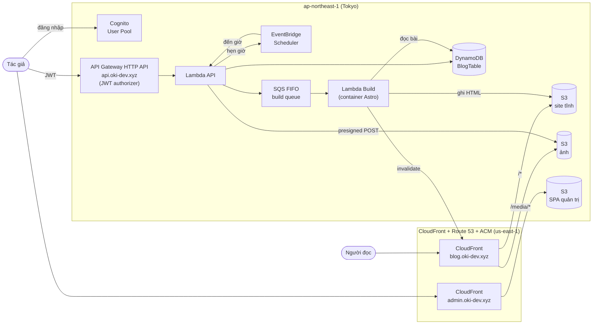

# Thiết kế: Blog cá nhân serverless — oki-dev.xyz

- **Ngày:** 2026-10-10
- **Trạng thái:** Đang thiết kế — Phần 1/5 đã duyệt
- **Tác giả:** Son Nguyen

---

## 0. Bối cảnh & mục tiêu

### Mục tiêu

Blog cá nhân, một tác giả duy nhất, viết bài qua trang quản trị trên web. Người đọc chỉ đọc.

### Tiêu chí thành công

- Người đọc mở bài thấy nội dung **ngay lập tức**, chuyển giữa các bài **mượt** (không trắng trang).
- Tác giả viết xong, bấm Publish → bài lên site trong **khoảng 1 phút** (mục tiêu 15–30 giây).
- Chi phí vận hành hàng tháng **gần như 0** ở quy mô blog cá nhân.
- Toàn bộ hạ tầng là code, deploy tự động khi push lên `main`.

### Ngoài phạm vi (phiên bản đầu)

- SEO (không phải ưu tiên).
- Bình luận, đăng ký thành viên, nhiều tác giả, phân quyền.
- Thư viện quản lý ảnh trong database.
- Môi trường dev/staging riêng.

### Quyết định đã chốt

| Chủ đề | Lựa chọn | Lý do |
|---|---|---|
| Mô hình | Có trang quản trị, bài lưu trong database | Viết bài trên web, không cần Git |
| Cách render cho người đọc | **SSG** (sinh HTML tĩnh khi publish) | Tải lần đầu nhanh nhất, gần như không tốn chi phí; không cần SEO nhưng SSG vẫn cho trải nghiệm tốt nhất |
| Chuyển trang | Kiểu SPA sau lần tải đầu (Astro View Transitions) | Ưu tiên đọc mượt |
| Site đọc | **Astro** (TypeScript) | Thiết kế cho site nội dung, gần như không JS, build nhanh |
| Trang quản trị | **React** SPA (Vite, TypeScript) | Ứng dụng tương tác, có đăng nhập |
| Soạn bài | **Markdown** + xem trước | Gọn, dễ sao lưu/di chuyển, tô màu code khi build |
| Backend | **Lambda Node.js** (TypeScript) | Cùng ngôn ngữ với frontend |
| Hạ tầng (IaC) | **AWS CDK** (TypeScript) | Gọn nhất, AWS quản lý state, cùng ngôn ngữ |
| Build khi publish | **Lambda container image** chạy `astro build` | Nhanh (15–30 s), ít thành phần, code site & code build luôn cùng phiên bản |
| Region chính | **`ap-northeast-1` (Tokyo)** | Chứng chỉ cho CloudFront đặt ở `us-east-1` (bắt buộc) |
| Môi trường | Chỉ **prod** | Đủ cho blog cá nhân |
| CI/CD | **GitHub Actions**, push `main` → deploy prod | Tự động hoá, xác thực AWS qua OIDC |

### Tính năng phiên bản đầu

- Viết / sửa / xoá / publish bài (Markdown).
- Upload ảnh trong bài.
- Tag / chuyên mục, có trang liệt kê theo tag.
- Bản nháp & lên lịch tự publish.
- Tìm kiếm bài viết.

### Tên miền

Tên miền `oki-dev.xyz` (mua ở GoDaddy, DNS đã chuyển về hosted zone Route 53).

| Địa chỉ | Dùng cho |
|---|---|
| `blog.oki-dev.xyz` | Site đọc (kèm ảnh ở `/media/*`) |
| `admin.oki-dev.xyz` | Trang quản trị |
| `api.oki-dev.xyz` | API cho trang quản trị |

Tên miền gốc `oki-dev.xyz` để dành cho mục đích khác.

### Giả định

- Một tài khoản AWS, một tài khoản quản trị duy nhất (tác giả).
- Quy mô: vài trăm bài trở xuống.

---

## 1. Kiến trúc tổng thể ✅

### Sơ đồ

### Thành phần

| Thành phần | Vai trò |
|---|---|
| **S3 + CloudFront (blog)** | Phục vụ HTML tĩnh. Ảnh dùng chung distribution qua đường dẫn `/media/*` |
| **S3 + CloudFront (admin)** | Phục vụ SPA React quản trị |
| **Cognito User Pool** | 1 tài khoản quản trị; tắt tự đăng ký; bật MFA |
| **API Gateway HTTP API + Lambda API** | JWT authorizer (Cognito); một Lambda xử lý các route CRUD |
| **DynamoDB** | Lưu bài viết (Markdown, metadata, trạng thái nháp/hẹn giờ/đã đăng) |
| **EventBridge Scheduler** | Đến giờ hẹn → chuyển bài sang "đã đăng" và kích hoạt build |
| **SQS FIFO + Lambda Build** | Hàng đợi đảm bảo **chỉ một build chạy tại một thời điểm**; gộp nhiều lần bấm liên tiếp thành một lần build |
| **Route 53 + ACM** | DNS + HTTPS. Chứng chỉ cho CloudFront ở `us-east-1`; chứng chỉ cho API Gateway ở Tokyo |
| **GitHub Actions** | Push `main` → test, build admin, `cdk deploy`. Đăng nhập AWS qua OIDC, không lưu access key |

### Nguyên tắc

1. **Người đọc không bao giờ gọi API.** Mọi thứ người đọc nhận là file tĩnh từ CloudFront → nhanh và không tốn chi phí Lambda.
2. **Tìm kiếm chạy hoàn toàn trên trình duyệt** bằng chỉ mục **Pagefind** sinh ra lúc build.
3. **Mọi bucket S3 đều private**; CloudFront đọc qua **OAC** (Origin Access Control).
4. **Chỉ một build tại một thời điểm** — mọi yêu cầu build đi qua SQS FIFO với cùng một message group.
5. **Code site và code build luôn cùng phiên bản** — mã nguồn Astro được đóng gói vào container image của Lambda Build, CDK build lại image mỗi lần deploy.

---

## 2. Dữ liệu & API

_Đang thiết kế._

## 3. Luồng publish & build

_Chưa thiết kế._

## 4. Trang quản trị & site đọc

_Chưa thiết kế._

## 5. Xử lý lỗi, bảo mật, kiểm thử & CI/CD

_Chưa thiết kế._
