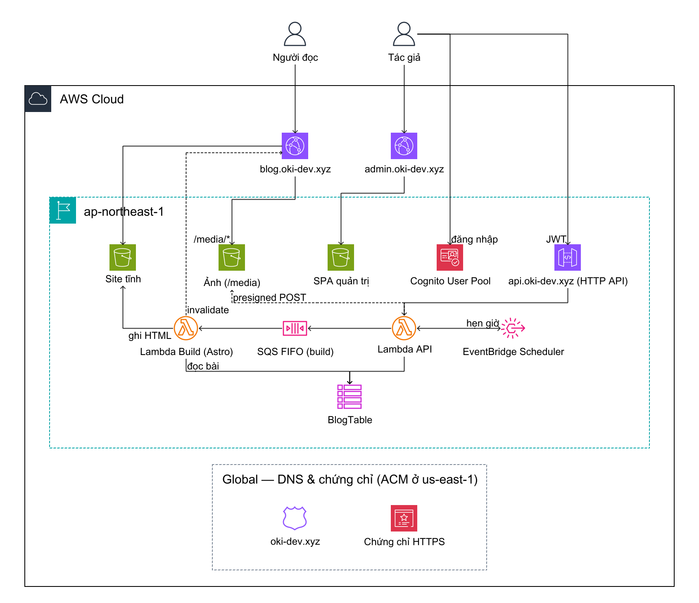
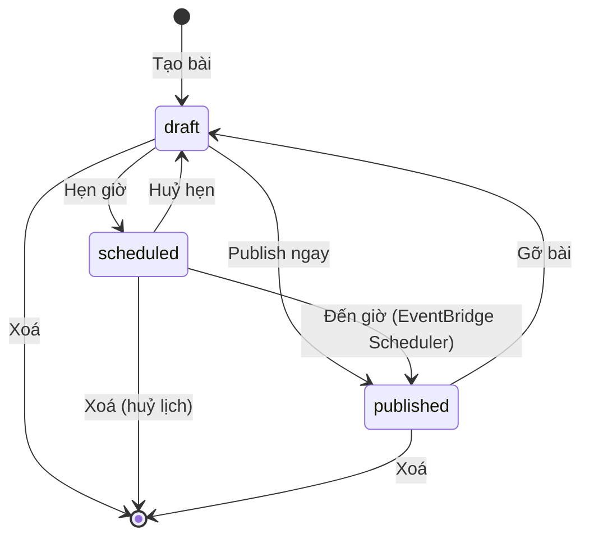

# Thiết kế: Blog cá nhân serverless — oki-dev.xyz

- **Ngày:** 2026-10-10
- **Trạng thái:** Thiết kế hoàn tất — chờ tác giả review spec
- **Tác giả:** Son Nguyen
- **Sửa đổi:** mục 2, 3.2, 4.1, 4.2, 4.3 và 5.4 được bổ sung/thay thế bởi [`2026-10-10-ui-i18n-design.md`](2026-10-10-ui-i18n-design.md) (giao diện C1, song ngữ vi/ja). Khi mâu thuẫn, tài liệu đó được ưu tiên.

---

## 0. Bối cảnh & mục tiêu

### Mục tiêu

Blog cá nhân, một tác giả duy nhất, viết bài qua trang quản trị trên web. Người đọc chỉ đọc.

### Tiêu chí thành công

- Người đọc mở bài thấy nội dung **ngay lập tức**, chuyển giữa các bài **mượt** (không trắng trang).
- Tác giả viết xong, bấm Publish → bài lên site trong **khoảng 30–60 giây**.
- Chi phí vận hành hàng tháng **gần như 0** ở quy mô blog cá nhân.
- Toàn bộ hạ tầng là code, deploy tự động khi push lên `main`.

### Ngoài phạm vi (phiên bản đầu)

- SEO (không phải ưu tiên).
- Bình luận, đăng ký thành viên, nhiều tác giả, phân quyền theo vai trò (ngoài nhóm `e2e` giới hạn quyền cho test).
- Thư viện quản lý ảnh trong database.
- Môi trường dev/staging riêng.
- Thông báo qua Discord (tạm bỏ; có thể thêm sau qua SNS → Lambda → webhook).
- WAF.

### Quyết định đã chốt

| Chủ đề | Lựa chọn | Lý do |
|---|---|---|
| Mô hình | Có trang quản trị, bài lưu trong database | Viết bài trên web, không cần Git |
| Cách render cho người đọc | **SSG** (sinh HTML tĩnh khi publish) | Tải lần đầu nhanh nhất, gần như không tốn chi phí; không cần SEO nhưng SSG vẫn cho trải nghiệm tốt nhất |
| Chuyển trang | Kiểu SPA sau lần tải đầu (Astro View Transitions) | Ưu tiên đọc mượt |
| Site đọc | **Astro** (TypeScript) | Thiết kế cho site nội dung, gần như không JS, build nhanh |
| Trang quản trị | **React** SPA (Vite, TypeScript) | Ứng dụng tương tác, có đăng nhập |
| Soạn bài | **Markdown** + xem trước | Gọn, dễ sao lưu/di chuyển, tô màu code khi build |
| Backend | **Lambda Node.js** (TypeScript) | Cùng ngôn ngữ với frontend |
| Hạ tầng (IaC) | **AWS CDK** (TypeScript) | Gọn nhất, AWS quản lý state, cùng ngôn ngữ |
| Build khi publish | **Lambda container image** chạy `astro build` | Nhanh (bài lên site trong ~30–60 s), ít thành phần, code site & code build luôn cùng phiên bản |
| Region chính | **`ap-northeast-1` (Tokyo)** | Chứng chỉ cho CloudFront đặt ở `us-east-1` (bắt buộc) |
| Môi trường | Chỉ **prod** | Đủ cho blog cá nhân |
| CI/CD | **GitHub Actions**, push `main` → deploy prod | Tự động hoá, xác thực AWS qua OIDC |
| Monorepo | **pnpm workspaces** | Chặn phantom dependency (lỗi chỉ lộ khi đóng gói Lambda/image), `pnpm deploy` tiện cho Dockerfile |
| Runtime Lambda | **Node.js** (runtime AWS quản lý) | Không phải tự bảo trì custom runtime như Deno/Bun |
| Kiểm thử E2E | **Playwright** trên prod, **không publish** | Chỉ có prod; không bao giờ đưa bài test lên site thật |
| Cảnh báo | **Email** (SNS) | Discord tạm bỏ |

### Tính năng phiên bản đầu

- Viết / sửa / xoá / publish bài (Markdown).
- Upload ảnh trong bài.
- Tag / chuyên mục, có trang liệt kê theo tag.
- Bản nháp & lên lịch tự publish.
- Tìm kiếm bài viết.

### Tên miền

Tên miền `oki-dev.xyz` (mua ở GoDaddy, DNS đã chuyển về hosted zone Route 53).

| Địa chỉ | Dùng cho |
|---|---|
| `blog.oki-dev.xyz` | Site đọc (kèm ảnh ở `/media/*`) |
| `admin.oki-dev.xyz` | Trang quản trị |
| `api.oki-dev.xyz` | API cho trang quản trị |

Tên miền gốc `oki-dev.xyz` để dành cho mục đích khác.

### Giả định

- Một tài khoản AWS. Cognito có một tài khoản quản trị (tác giả) và một tài khoản E2E bị giới hạn quyền (mục 5.4).
- Quy mô: vài trăm bài trở xuống.

---

## 1. Kiến trúc tổng thể ✅

### Sơ đồ



> Sơ đồ vẽ bằng [awsdac](https://github.com/awslabs/diagram-as-code), nguồn: [`docs/diagrams/architecture.yaml`](../../diagrams/architecture.yaml).
> Vẽ lại: `rm -f docs/diagrams/architecture.png && awsdac docs/diagrams/architecture.yaml -o docs/diagrams/architecture.png`
> (awsdac hỏi xác nhận nếu file PNG đã tồn tại, nên xoá trước khi vẽ lại.)

<details>
<summary>Phiên bản Mermaid (xem nhanh trên GitHub)</summary>


</details>

### Thành phần

| Thành phần | Vai trò |
|---|---|
| **S3 + CloudFront (blog)** | Phục vụ HTML tĩnh. Ảnh dùng chung distribution qua đường dẫn `/media/*` |
| **S3 + CloudFront (admin)** | Phục vụ SPA React quản trị |
| **Cognito User Pool** | Tài khoản quản trị + tài khoản E2E (nhóm `e2e`, bị giới hạn quyền); tắt tự đăng ký; bắt buộc MFA |
| **API Gateway HTTP API + Lambda API** | JWT authorizer (Cognito); một Lambda xử lý các route CRUD |
| **DynamoDB** | Lưu bài viết (Markdown, metadata, trạng thái nháp/hẹn giờ/đã đăng) |
| **EventBridge Scheduler** | Đến giờ hẹn → chuyển bài sang "đã đăng" và kích hoạt build |
| **SQS FIFO + Lambda Build** | Hàng đợi đảm bảo **chỉ một build chạy tại một thời điểm**; gộp nhiều lần bấm liên tiếp thành một lần build |
| **Route 53 + ACM** | DNS + HTTPS. Chứng chỉ cho CloudFront ở `us-east-1`; chứng chỉ cho API Gateway ở Tokyo |
| **GitHub Actions** | Push `main` → test, build admin, `cdk deploy`. Đăng nhập AWS qua OIDC, không lưu access key |

### Nguyên tắc

1. **Người đọc không bao giờ gọi API.** Mọi thứ người đọc nhận là file tĩnh từ CloudFront → nhanh và không tốn chi phí Lambda.
2. **Tìm kiếm chạy hoàn toàn trên trình duyệt** bằng chỉ mục **Pagefind** sinh ra lúc build.
3. **Mọi bucket S3 đều private**; CloudFront đọc qua **OAC** (Origin Access Control).
4. **Chỉ một build tại một thời điểm** — mọi yêu cầu build đi qua SQS FIFO với cùng một message group.
5. **Code site và code build luôn cùng phiên bản** — mã nguồn Astro được đóng gói vào container image của Lambda Build, CDK build lại image mỗi lần deploy.

---

## 2. Dữ liệu & API ✅

### DynamoDB — một bảng `BlogTable`

Khoá chính gồm **PK** (partition key — quyết định item nằm ở "ngăn" nào, cần biết để đọc nhanh) và **SK** (sort key — phân biệt/sắp xếp các item cùng PK). Cặp PK + SK là duy nhất. Bảng chứa nhiều loại dữ liệu, phân biệt bằng tiền tố của PK (single-table design). Chế độ tính tiền: **on-demand**.

| Loại item | PK | SK | Mục đích |
|---|---|---|---|
| Bài viết | `POST#<id>` | `POST` | Nội dung + metadata bài |
| Giữ slug | `SLUG#<slug>` | `SLUG` | Đảm bảo slug duy nhất; chứa `postId` |
| Trạng thái build | `BUILD` | `LATEST` | Trang quản trị hiển thị tình trạng build |

SK hiện chưa bắt buộc (mỗi PK một item) nhưng giữ lại để mở rộng (ví dụ lịch sử phiên bản `SK = VERSION#<n>`).

#### Item bài viết

| Trường | Ghi chú |
|---|---|
| `id` | ULID, sinh tự động |
| `slug` | Duy nhất, dùng trong URL `/posts/<slug>` |
| `title`, `excerpt`, `content` | `content` là Markdown. Giới hạn item 400KB của DynamoDB là quá đủ |
| `tags` | Danh sách chuỗi, ví dụ `["aws","serverless"]` |
| `coverImage` | Đường dẫn ảnh bìa, tuỳ chọn |
| `status` | `draft` \| `scheduled` \| `published` |
| `publishAt`, `publishedAt`, `createdAt`, `updatedAt` | ISO 8601, UTC |
| `version` | Số nguyên, tăng mỗi lần lưu — chống ghi đè khi mở cùng bài ở hai tab (optimistic locking) |
| `GSI1PK`, `GSI1SK` | `"POST"` và `updatedAt` — phục vụ GSI `byUpdated` |

#### Giữ slug duy nhất

Tạo bài hoặc đổi slug → **một transaction** ghi item bài viết + item `SLUG#<slug>` với điều kiện "chưa tồn tại" (và xoá item slug cũ khi đổi slug). Slug đã được dùng → transaction thất bại → API trả `409`.

#### Trạng thái build

`status`: `queued` | `running` | `success` | `failed`, kèm `updatedAt` và `error` (nếu thất bại).

#### GSI `byUpdated`

`GSI1PK = "POST"`, `GSI1SK = updatedAt`. Liệt kê mọi bài theo thời gian sửa mới nhất — dùng cho trang quản trị và Lambda Build. Quy mô vài trăm bài → một query là đủ.

#### Tag

Không có bảng riêng. Trang danh sách theo tag được sinh lúc build từ trường `tags`.

### Vòng đời trạng thái bài viết



**Thao tác kích hoạt build:** publish (ngay hoặc khi đến giờ), gỡ bài, xoá bài đã đăng, **lưu thay đổi cho bài đang `published`**. Sửa bản nháp / bài đang hẹn giờ **không** build.

### API — `api.oki-dev.xyz`

Mọi route yêu cầu JWT của Cognito (JWT authorizer của API Gateway HTTP API). Người dùng thuộc nhóm Cognito **`e2e`** bị Lambda API từ chối (`403`) ở các route `publish`, `unpublish` và `POST /builds` — đảm bảo test E2E không bao giờ đưa nội dung lên site thật.

| Method | Route | Chức năng |
|---|---|---|
| GET | `/posts` | Liệt kê tất cả bài (mọi trạng thái) |
| POST | `/posts` | Tạo bản nháp |
| GET | `/posts/{id}` | Chi tiết bài |
| PUT | `/posts/{id}` | Cập nhật; gửi kèm `version`. Lệch version → `409` |
| DELETE | `/posts/{id}` | Xoá bài (huỷ lịch hẹn nếu có) |
| POST | `/posts/{id}/publish` | Body `{ publishAt? }` — không có hoặc ở quá khứ → đăng ngay; ở tương lai → hẹn giờ |
| POST | `/posts/{id}/unpublish` | Gỡ bài / huỷ hẹn → về `draft` |
| POST | `/uploads` | Trả presigned POST để upload ảnh thẳng lên S3 (≤ 10MB, chỉ `image/*`) |
| GET | `/builds/latest` | Trạng thái build gần nhất |
| POST | `/builds` | Build lại thủ công |

### Ảnh

- Key: `media/<yyyy>/<ulid>.<ext>`, phục vụ qua `https://blog.oki-dev.xyz/media/...`. Ảnh do tài khoản E2E upload nằm ở `media/e2e/...` và được **S3 lifecycle tự xoá sau 1 ngày**.
- Presigned **POST** (không phải PUT) để S3 tự áp giới hạn dung lượng (`content-length-range`) và `Content-Type`.
- Phiên bản đầu **không** theo dõi ảnh trong database (YAGNI) — ảnh không còn được dùng vẫn nằm lại trong S3.

## 3. Luồng publish & build ✅

### 3.1 Publish ngay

1. Tác giả bấm Publish → Lambda API đặt `status = published`, ghi `publishedAt`.
2. Lambda API gửi message vào SQS FIFO, ghi `BUILD/LATEST = queued`, trả về ngay (< 1 s).
3. Lambda Build nhận message → build (mục 3.3).
4. Trang quản trị gọi `GET /builds/latest` mỗi vài giây cho tới khi `success`/`failed`.

### 3.2 Hẹn giờ

- Publish với `publishAt` ở tương lai → `status = scheduled` + tạo **one-time schedule** trên EventBridge Scheduler: tên `post-<id>`, biểu thức `at(<publishAt UTC>)`, `ActionAfterCompletion: DELETE` (tự xoá sau khi chạy).
- Đến giờ, Scheduler gọi Lambda API (handler riêng, cùng code). Handler chỉ chuyển sang `published` **khi bài vẫn `scheduled` và `publishAt` khớp** — tránh lịch cũ chạy sau khi tác giả đã đổi giờ/huỷ. Sau đó gửi message build như 3.1.
- Đổi giờ / huỷ hẹn / xoá bài → xoá schedule cũ (không tồn tại thì bỏ qua).
- **Múi giờ:** trang quản trị cho chọn giờ hẹn theo **giờ Việt Nam (`Asia/Ho_Chi_Minh`, UTC+7)** hoặc **giờ Nhật (`Asia/Tokyo`, UTC+9)** qua một ô chọn múi giờ cạnh ô chọn ngày giờ; lựa chọn được nhớ trên trình duyệt. Thời điểm hẹn hiển thị kèm giờ ở múi còn lại để đối chiếu (ví dụ "08:00 JST · 06:00 giờ VN"). Server luôn nhận và lưu **UTC**.

### 3.3 Lambda Build

| Bước | Chi tiết |
|---|---|
| 1. Ghi trạng thái | `BUILD/LATEST = running` |
| 2. Đọc dữ liệu | Query GSI `byUpdated`, lọc bài `published`, qua content loader tự viết của Astro |
| 3. `astro build` | Sinh HTML (trang chủ, từng bài, từng tag) + chạy Pagefind tạo chỉ mục tìm kiếm. Output vào `/tmp/dist` |
| 4. Đồng bộ S3 | Upload mọi file không phải HTML trước → upload HTML → **xoá trang thừa** (ví dụ bài vừa gỡ). Thứ tự này đảm bảo HTML không bao giờ trỏ tới asset chưa tồn tại |
| 5. Invalidate | CloudFront invalidation `/*` (1.000 path/tháng miễn phí), **chờ hoàn tất** (tối đa 2 phút) rồi mới xoá asset có hash cũ (`/_astro/*`) — HTML cũ còn trong cache CloudFront vẫn tải được CSS/JS. Chưa xong trong 2 phút → giữ asset cũ, lượt build sau dọn |
| 6. Ghi trạng thái | `success`, hoặc `failed` kèm thông báo lỗi |

Cấu hình: container image, 2048 MB RAM, timeout 5 phút, ephemeral storage `/tmp` 2 GB.

### 3.4 Một build tại một thời điểm & gộp build

- Mọi message dùng chung `MessageGroupId = "site"` → Lambda xử lý **tuần tự**, không bao giờ có hai build cùng ghi S3.
- Batch size 10: một lần gọi nhận tối đa 10 message nhưng **chỉ build một lần**. Nhiều thay đổi dồn lại trong lúc đang build → gộp thành một build kế tiếp.
- Build đọc dữ liệu **mới nhất tại thời điểm bắt đầu**; thay đổi xảy ra sau đó có message riêng → được build ở lượt sau, không bị sót.
- `MessageDeduplicationId` là ID ngẫu nhiên cho mỗi yêu cầu (không dùng content-based dedup, để hai yêu cầu giống nhau trong 5 phút không bị nuốt mất).

### 3.5 Build lỗi

- **Site cũ giữ nguyên** — chỉ đồng bộ S3 khi `astro build` thành công.
- SQS thử lại 1 lần (`maxReceiveCount = 2`); vẫn lỗi → message vào **DLQ**, `BUILD/LATEST = failed` kèm lỗi.
- Trang quản trị hiển thị lỗi + nút **"Build lại"** (`POST /builds`).
- **Cảnh báo:** message rơi vào DLQ → CloudWatch Alarm → SNS → **email**. Chi tiết ở Phần 5.

### 3.6 Thời gian thực tế

`astro build` ~10–20 s; tính cả cold start container, đồng bộ S3 và CloudFront invalidation → **bấm Publish đến khi bài hiện trên site: khoảng 30–60 giây**.

## 4. Site đọc, trang quản trị & cấu trúc code ✅

### 4.1 Site đọc (Astro) — `blog.oki-dev.xyz`

#### Trang

| Đường dẫn | Nội dung |
|---|---|
| `/` | Bài mới nhất, 10 bài/trang (`/page/2`, …) |
| `/posts/<slug>` | Bài viết: tiêu đề, ngày, tag, ảnh bìa, nội dung |
| `/tags`, `/tags/<tag>` | Danh sách tag; bài theo tag |
| `/search` | Tìm kiếm (Pagefind) |
| `/404` | Không tìm thấy |

#### Tốc độ & độ mượt

- **View Transitions** (`<ClientRouter />`) — chuyển trang kiểu SPA, không trắng trang.
- **Prefetch khi rê chuột** vào link.
- **Gần như không JavaScript**; chỉ `/search` tải Pagefind.
- **Shiki** tô màu code lúc build.
- Ảnh `loading="lazy"`; trang quản trị **thu nhỏ ảnh trước khi upload** (cạnh dài tối đa 1600px, WebP).
- Giao diện sáng/tối theo hệ điều hành.
- **Cache:** `/_astro/*` (tên file có hash) → `Cache-Control: public, max-age=31536000, immutable`. HTML → trình duyệt `max-age=0, must-revalidate`; CloudFront cache lâu dài, chỉ làm mới khi invalidate sau mỗi build.

#### Ngày giờ

Hiển thị **theo múi giờ máy người đọc**. HTML chứa `<time datetime="<UTC ISO>">` kèm ngày dự phòng; một script inline nhỏ định dạng lại bằng `Intl.DateTimeFormat` trước khi hiển thị và chạy lại sau mỗi lần chuyển trang (sự kiện `astro:page-load`).

### 4.2 Trang quản trị (React + Vite) — `admin.oki-dev.xyz`

#### Đăng nhập

**Cognito Managed Login**, OAuth 2.0 authorization code + PKCE. Không tự làm form mật khẩu/MFA.

#### Màn hình

| Màn hình | Chức năng |
|---|---|
| Danh sách bài | Lọc theo trạng thái, tìm theo tiêu đề, xem thời gian sửa/giờ hẹn |
| Soạn bài | Markdown (trái) + xem trước (phải). Tiêu đề; slug tự sinh từ tiêu đề, bỏ dấu tiếng Việt (`"Học AWS"` → `hoc-aws`), sửa được; tag có gợi ý; tóm tắt; ảnh bìa |
| Chèn ảnh | Kéo-thả / dán ảnh → thu nhỏ → upload (presigned POST) → tự chèn `` |
| Hộp thoại Publish | "Đăng ngay" hoặc "Hẹn giờ" + chọn múi giờ VN/JP (mục 3.2) |
| Thanh trạng thái build | Đang build / thành công / thất bại + nút "Build lại" |

#### Lưu bài

- **Bản nháp & bài đang hẹn giờ:** tự lưu sau 3 giây kể từ lần gõ cuối.
- **Bài đã đăng:** không tự lưu; bấm **"Cập nhật"** (tránh mỗi lần gõ sinh một build và đưa nội dung dở dang lên site).
- API trả `409` (bài đã bị sửa ở tab khác) → báo xung đột, cho chọn tải lại bản mới hoặc ghi đè.

#### Xem trước khớp bài thật

Site đọc và trang quản trị **dùng chung package `markdown`** (remark/rehype + Shiki) để chuyển Markdown → HTML.

### 4.3 Cấu trúc code — monorepo pnpm workspaces

```
my-blog/
├── apps/
│   ├── site/          # Astro — site đọc (đóng gói vào image Lambda Build)
│   └── admin/         # React + Vite — trang quản trị
├── services/
│   ├── api/           # Lambda API + handler lịch hẹn
│   └── build/         # Lambda Build: Dockerfile + handler (astro build, đồng bộ S3, invalidate)
├── packages/
│   ├── shared/        # Kiểu Post, trạng thái, schema (zod) dùng chung
│   └── markdown/      # Markdown → HTML, dùng chung site + admin
├── infra/             # CDK app (TypeScript)
├── e2e/               # Playwright — test E2E trên prod
└── docs/
```

#### Phân lớp trong `services/api`

Không áp dụng DDD đầy đủ (miền nghiệp vụ nhỏ: một khái niệm chính là bài viết). Mượn ý tưởng **tách logic nghiệp vụ khỏi AWS** (kiểu hexagonal nhẹ):

```
services/api/src/
├── domain/      # Hàm thuần, KHÔNG import AWS SDK: chuyển trạng thái bài, kiểm tra hợp lệ, sinh slug
├── usecases/    # Điều phối: đọc → gọi domain → ghi → gửi build / tạo lịch
├── adapters/    # DynamoDB (postRepo), SQS (buildQueue), EventBridge Scheduler (scheduler)
└── handlers/    # Nhận event API Gateway / Scheduler → gọi use case → trả kết quả
```

- `domain/` test thuần, không cần AWS hay mock.
- Đổi hạ tầng chỉ đụng `adapters/`.
- Các app/service còn lại giữ cấu trúc đơn giản.

## 5. Xử lý lỗi, bảo mật, giám sát, kiểm thử & CI/CD ✅

### 5.1 Xử lý lỗi (API)

Định dạng lỗi thống nhất: `{ "error": { "code": "SLUG_TAKEN", "message": "..." } }`.

| HTTP | Khi nào |
|---|---|
| `400` | Dữ liệu không hợp lệ (zod schema trong `packages/shared`) |
| `401` | Thiếu/hết hạn JWT (API Gateway tự trả) |
| `403` | Tài khoản E2E gọi route bị cấm |
| `404` | Không tìm thấy bài |
| `409` | Lệch `version` hoặc slug đã bị dùng |
| `500` | Lỗi khác — log đầy đủ kèm `requestId`, người dùng chỉ thấy thông báo chung |

- Log JSON bằng **Powertools for AWS Lambda (TypeScript)**; giữ log **30 ngày**.
- Trang quản trị hiển thị lỗi tương ứng; `401` → tự làm mới token, không được thì chuyển về đăng nhập.

### 5.2 Bảo mật

| Hạng mục | Cách làm |
|---|---|
| Cognito | Tắt tự đăng ký; **bắt buộc MFA (TOTP)**; mật khẩu mạnh. Tài khoản quản trị và E2E tạo **bằng tay qua CLI một lần**, không để mật khẩu trong code |
| API | JWT authorizer chỉ nhận token của app client admin; CORS chỉ `https://admin.oki-dev.xyz`; throttling 20 req/s, burst 40 |
| S3 | Block Public Access; CloudFront đọc qua OAC; SSE-S3; bắt buộc HTTPS (bucket policy `aws:SecureTransport`) |
| Upload ảnh | Presigned POST hết hạn 5 phút, chỉ `image/*`, ≤ 10MB, **key do server sinh** |
| Markdown | **Tắt HTML thô** + `rehype-sanitize` — lớp chống XSS phòng khi tài khoản bị lộ |
| Header | CloudFront response headers policy: HSTS, `X-Content-Type-Options`, `Referrer-Policy`, `X-Frame-Options`; trang admin thêm **CSP** (chỉ kết nối tới API và Cognito) |
| IAM | Quyền tối thiểu qua `grant*` của CDK (ví dụ Lambda Build chỉ đọc bảng, ghi bucket site, invalidate distribution blog) |
| GitHub OIDC | Role deploy chỉ tin đúng repo GitHub của blog (tên owner/repo truyền vào CDK qua context) và nhánh `refs/heads/main`. E2E gọi API bằng JWT của tài khoản E2E, không cần quyền AWS |
| Bảo vệ dữ liệu | DynamoDB **PITR**; bucket ảnh **versioning**; bảng + bucket ảnh `RemovalPolicy.RETAIN` |

### 5.3 Giám sát & cảnh báo (email)

```
CloudWatch Alarms / AWS Budgets ──► SNS topic "blog-alerts" ──► Email
```

| Cảnh báo | Điều kiện |
|---|---|
| Build thất bại | DLQ có ≥ 1 message |
| Lambda API lỗi | ≥ 5 lỗi trong 5 phút |
| Lambda Build lỗi | ≥ 1 lỗi |
| Vượt ngân sách | AWS Budgets: chi phí dự kiến tháng > $5 |

Alarm gửi cả khi trở lại `OK` để biết sự cố đã hết. Email nhận cảnh báo truyền vào CDK qua context, không hard-code.

### 5.4 Kiểm thử

| Tầng | Cách test | Công cụ |
|---|---|---|
| `domain/`, slug, `markdown` | Unit test hàm thuần | Vitest |
| `usecases/` | Adapter giả trong bộ nhớ (in-memory fake) | Vitest |
| `adapters/` | Mock AWS SDK | `aws-sdk-client-mock` |
| Site Astro | `astro build` với **dữ liệu mẫu** (content loader đọc JSON thay DynamoDB), kiểm tra các trang chính được sinh | Vitest + script |
| Hạ tầng | Assertion các thuộc tính bảo mật (bucket không public, API có authorizer, bật PITR…) | `aws-cdk-lib/assertions` |
| Admin | Component test phần có logic (hộp thoại Publish, chuyển múi giờ) | Vitest + Testing Library |
| **E2E** | Trên **prod**, sau mỗi lần deploy, **chỉ đọc** (chi tiết dưới) | **Playwright** |

#### E2E (chỉ đọc, sau mỗi lần deploy)

> Quyết định 2026-10-11: **bỏ E2E có đăng nhập** (blog một tác giả; MFA bắt buộc làm tài khoản E2E mong manh và thêm một tài khoản ghi được vào prod; logic API đã có unit/integration test). Không có tài khoản E2E, không ghi dữ liệu prod.

**Smoke (HTTP, không trình duyệt):**

- Blog: `/`, `/vi/`, `/ja/`, `/vi/tags/`, `/ja/tags/`, `/vi/search/`, `/pagefind/pagefind.js` → 200; đường dẫn lạ → 404; có HSTS, `nosniff`, `X-Frame-Options`.
- API: `GET /posts` không token → 401.
- Admin: `/` có CSP (`script-src 'self' 'wasm-unsafe-eval'`, `frame-ancestors 'none'`) và `no-cache`; `/config.json` trỏ đúng API + domain Cognito.

**Site đọc (Playwright, Chromium, chạy hai lần với `timezoneId` Asia/Tokyo và Asia/Ho_Chi_Minh):**

- `/` tiếng Việt; bấm `[vi|ja]` → `/ja/`; mở lại `/` → tự sang `/ja/`.
- Ngày hiển thị theo múi giờ trình duyệt.
- Mở một bài → nội dung hiển thị, không tải lại toàn trang (ClientRouter).
- Trang tìm kiếm tải giao diện Pagefind; đường dẫn lạ → trang 404.
- Blog chưa có bài nào → các test cần bài viết được **skip**, không fail.

### 5.5 CI/CD — GitHub Actions

#### Quy tắc nhánh: mọi thay đổi vào `main` phải qua Pull Request

Cấu hình bằng **GitHub ruleset** cho nhánh `main`:

| Quy tắc | Giá trị |
|---|---|
| Bắt buộc Pull Request | Có — **cấm push trực tiếp** lên `main` |
| Số người duyệt bắt buộc | 0 (một tác giả, GitHub không cho tự duyệt PR của mình) |
| Status check bắt buộc | Job CI của workflow PR phải xanh |
| Nhánh phải cập nhật với `main` trước khi merge | Có |
| Cấm force push / xoá nhánh `main` | Có |
| Cho phép bỏ qua (bypass) | **Không** — kể cả admin |
| Kiểu merge | **Squash merge** — mỗi PR thành một commit trên `main` |

Quy trình làm việc: tạo nhánh (`feat/...`, `fix/...`) → push → mở PR → CI xanh → merge → workflow deploy tự chạy.

> Ruleset cho repo **private** cần gói GitHub Pro/Team; repo **public** dùng miễn phí.

| Sự kiện | Bước |
|---|---|
| Pull request | `pnpm install` → lint → typecheck → unit/integration test → `cdk synth` |
| Push `main` (chỉ xảy ra khi merge PR) | Như trên → build admin → `cdk deploy --all` → gửi message build vào SQS (build lại site bằng image mới) → **chờ build `success`** (đọc item `BUILD/LATEST`, timeout 5 phút) → **chạy smoke + E2E chỉ đọc** |

- `concurrency` group: không bao giờ hai lượt deploy chồng nhau.
- **CI của PR không cần quyền AWS:** CDK không dùng `fromLookup`; hosted zone ID, tên miền, email cảnh báo, owner/repo GitHub truyền qua `cdk.json` context → `cdk synth` chạy được mà không cần đăng nhập AWS.
- E2E thất bại → workflow đỏ → GitHub gửi email. Không tự rollback (bản đầu).
- **Cấu hình admin** (URL API, Cognito ID) do CDK sinh thành `/config.json` khi deploy → admin build một lần, không phụ thuộc output deploy.
- **Kiến trúc CPU:** Lambda zip (API) chạy **arm64**; Lambda Build (container) chạy **x86_64** để build image trên runner GitHub không cần giả lập ARM.
- **Stack CDK:**
  - `CertStack` (`us-east-1`) — chứng chỉ CloudFront.
  - `BlogStack` (`ap-northeast-1`) — mọi thứ còn lại, dùng `crossRegionReferences`.
  - `CiStack` — OIDC provider + role deploy cho GitHub, deploy tay một lần.
- **Việc làm tay một lần:** tạo repo GitHub + ruleset cho `main`; `cdk bootstrap` hai region; deploy `CiStack` (`BlogCi`); tạo tài khoản quản trị trên Cognito và thiết lập MFA.
- **Dọn image ECR:** chạy `cdk gc` định kỳ để xoá image không còn dùng.

### 5.6 Chi phí ước tính / tháng

| Hạng mục | Chi phí |
|---|---|
| Route 53 hosted zone | $0.50 |
| ECR (image Lambda Build) | ~$0.10 |
| CloudFront, S3, Lambda, DynamoDB, SQS, Scheduler, Cognito | ~$0 (free tier / mức dùng rất thấp) |
| **Tổng** | **~$1/tháng** |
